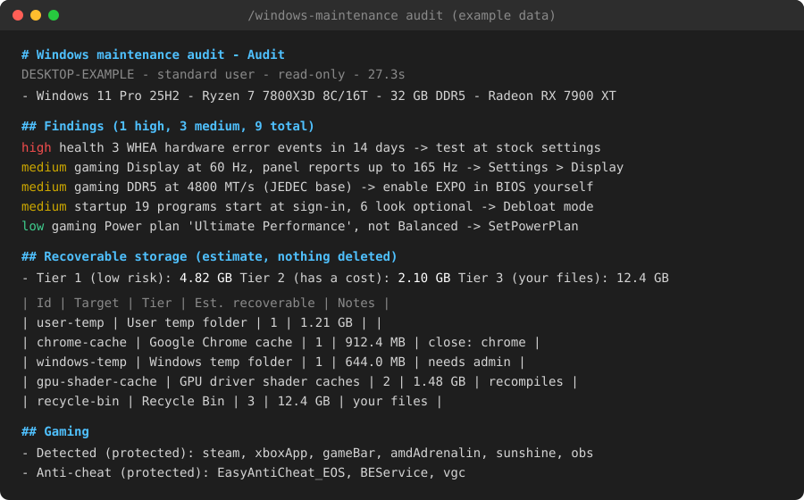

<div align="center">


# windows-maintenance

**A safety-first Claude Code skill for cleaning, diagnosing and optimising a Windows 11 gaming + development PC.**

[](https://code.claude.com/docs/en/plugins)
[](#requirements)
[](#requirements)
[](#design)
[](LICENSE)

`audit` · `clean` · `debloat` · `optimise` · `deep` · auto-updates as a plugin

</div>

---

Most Windows "optimizer" scripts do too much at once: they delete event logs, strip Xbox components, disable security features and apply registry tweaks nobody can measure. This skill does the opposite. It **audits read-only first**, **estimates** what it can recover, **asks** before every change, **backs up** before applying anything, and finishes with a **before-and-after report**. Gaming platforms, streaming tools, anti-cheat and Windows security are protected **in code**, not just in instructions.

<div align="center">

<br><sub>Example audit summary. The data is illustrative, not from a real machine.</sub>
</div>

## Contents

- [What it does](#what-it-does)
- [Install](#install)
- [Usage](#usage)
- [How a run works](#how-a-run-works)
- [Safety model](#safety-model)
- [What gets cleaned](#what-gets-cleaned)
- [What it checks for gaming](#what-it-checks-for-gaming)
- [What it will never do](#what-it-will-never-do)
- [Scripts](#scripts)
- [Repository layout](#repository-layout)
- [Output files](#output-files)
- [Design and credits](#design)
- [Requirements](#requirements)
- [Limitations](#limitations)
- [License](#license)

## What it does

| Mode | Changes anything? | What you get |
|---|---|---|
| **audit** (default) | No | Full read-only analysis: system, storage, recoverable space, startup, services, apps, performance, gaming, drivers, stability, security, dev environment. Findings ranked by severity with a recommendation for each. |
| **clean** | Only what you approve | Temp files, caches (browser, Discord, VS Code, launchers, package managers), logs, crash reports and installer leftovers, sorted into risk tiers with size estimates. |
| **debloat** | Only what you approve | Optional startup programs, preinstalled Store apps, unnecessary third-party auto-start services, trialware and "optimizer" utilities. Every change is reversible. |
| **optimise** | Only what you approve | Evidence-based gaming checks: refresh rate, RAM speed (EXPO/XMP) and channels, power plan, Game Mode, AMD X3D core-parking requirements, GPU driver age, stability errors (WHEA/TDR/BSOD), library drive type, network link. |
| **deep** | Only what you approve | All of the above, plus elevated checks (DISM component store, image health, SMART wear) and a node_modules scan, combined into a prioritised maintenance plan. |

## Install

This repository is a Claude Code **plugin marketplace**, so installing it as a plugin gives you updates without re-downloading anything. You need Claude Code on a Windows PC; nothing else needs installing.

### Quick start (3 steps)

1. **Install.** Open PowerShell and run this one command. It adds the marketplace and installs the plugin:

   ```powershell
   claude plugin install windows-maintenance --marketplace mckenna654/windows-maintenance
   ```

2. **Turn on automatic updates.** Start Claude Code, type `/plugin`, then go to **Marketplaces** → **windows-maintenance** → enable auto-update.
   If `/plugin` doesn't open a menu (for example in the desktop app), ask Claude:
   *"Turn on auto-update for the windows-maintenance plugin marketplace in my user settings."*

3. **Use it.** Start a new session and type `/windows-maintenance:windows-maintenance`, or just ask *"check my PC"*. It always starts with a read-only audit and asks before changing anything.

### Other ways to install

**Inside a Claude Code session:**

```text
/plugin marketplace add mckenna654/windows-maintenance
/plugin install windows-maintenance@windows-maintenance
```

**From a terminal, in two steps:**

```powershell
claude plugin marketplace add mckenna654/windows-maintenance
claude plugin install windows-maintenance@windows-maintenance
```

Start a new session (or run `/reload-plugins`) and the skill is ready.

### Automatic updates

Claude Code only auto-updates third-party marketplaces once you switch it on. Do this once:

- **In the app:** `/plugin` → **Marketplaces** → `windows-maintenance` → enable auto-update, **or**
- **Ask Claude:** *"Turn on auto-update for the windows-maintenance plugin marketplace in my user settings."* Claude makes the settings change below for you, **or**
- **In settings yourself:** add this to `%USERPROFILE%\.claude\settings.json` (merge it into any existing `extraKnownMarketplaces`):

  ```json
  {
    "extraKnownMarketplaces": {
      "windows-maintenance": {
        "source": { "source": "github", "repo": "mckenna654/windows-maintenance" },
        "autoUpdate": true
      }
    }
  }
  ```

With auto-update on, Claude Code checks for a new version shortly after a session starts (within about 10 minutes), downloads it in the background, and shows *Plugin updated*. The update applies after `/reload-plugins` or your next session. Every commit to `main` counts as a new version. To update by hand at any time:

```powershell
claude plugin marketplace update windows-maintenance
```

### Uninstall

```powershell
claude plugin uninstall windows-maintenance@windows-maintenance
claude plugin marketplace remove windows-maintenance
```

<details>
<summary>Upgrading from the old <code>git clone</code> install</summary>

Earlier versions were installed by cloning the repo into `%USERPROFILE%\.claude\skills\windows-maintenance`. That layout no longer works. Install the plugin as above, then delete the old folder so you don't have two copies:

```powershell
Remove-Item -Recurse -Force "$env:USERPROFILE\.claude\skills\windows-maintenance"
```

Your reports, backups and change journal live in `%LOCALAPPDATA%\WindowsMaintenance` and are kept.
</details>

## Usage

Plugin skills are named `plugin:skill`, so the command is:

```text
/windows-maintenance:windows-maintenance              # read-only audit
/windows-maintenance:windows-maintenance clean        # free disk space
/windows-maintenance:windows-maintenance debloat      # startup items, apps, services
/windows-maintenance:windows-maintenance optimise     # gaming performance checks
/windows-maintenance:windows-maintenance deep         # everything + maintenance plan
```

You can also just ask, e.g. *"my PC feels slow, can you check it?"* or *"free up some space on C:"*. Claude picks the skill up from its description.

## How a run works

```text
1. Assess    read-only audit  -> JSON snapshot + Markdown report
2. Plan      findings + proposed actions grouped:
               A  safe & reversible      (tier-1 cleanup, optional startup items, Balanced plan)
               B  has a cost / admin     (tier-2 cleanup, services -> Manual, Store app removal)
               C  your call / manual     (Recycle Bin, BIOS EXPO, hardware, uninstalls)
3. Ask       explicit approval per group/item. Nothing happens without it
4. Protect   config backup; restore point before system-level changes
5. Execute   dry run first, then exactly the approved items
6. Verify    second audit + before-and-after report (freed space measured on the drive)
```

Admin-only steps never self-elevate. Claude tells you a Windows UAC prompt is coming, and approving it is your consent for that single step.

## Safety model

Protection is enforced by the scripts, so it holds even if an instruction is misread:

- **Allow-listed cleanup only.** Only targets defined in [`config/clean-targets.json`](plugins/windows-maintenance/skills/windows-maintenance/config/clean-targets.json) can be cleaned. Arbitrary paths are impossible.
- **Deny-list re-checked before every delete.** [`config/protected.json`](plugins/windows-maintenance/skills/windows-maintenance/config/protected.json) blocks personal folders, game saves and libraries, dev project folders, credentials and keys, browser profile data, app settings and core Windows folders. A cleanup root that is inside, *or contains*, a protected location is refused.
- **Careful file walker.** It never follows junctions or symlinks, skips files in use, skips `.git`, `saves`, `userdata`, `steamapps`, `Cookies`, `Login Data` and similar names, honours per-target age filters, and never deletes the root folder itself.
- **Never kills apps.** If Chrome, Discord or Steam is running, that target is skipped and you are asked to close the app.
- **Protected functionality.** No override exists for Steam; Xbox app, Game Pass, Gaming Services and Game Bar; Microsoft Store; AMD Adrenalin and chipset services (including the 3D V-Cache optimizer); Moonlight, Sunshine, Apollo, Parsec, OBS and virtual display drivers; Tailscale and ZeroTier; or anti-cheat (EasyAntiCheat, BattlEye, Vanguard, FACEIT, EA AntiCheat, XIGNCODE and more).
- **Security is report-only.** Defender, Firewall, SmartScreen, UAC, Secure Boot, TPM, BitLocker, VBS/Memory Integrity, Windows Update and Smart App Control are never disabled or reconfigured.
- **Reversible changes.** Startup items are disabled through `StartupApproved`, the same switch Task Manager uses. Services only go Automatic → Manual, never Disabled. Store apps are removed per user and can be reinstalled. Every change is journaled with its previous state, and `Undo-Change.ps1` reverses it.
- **Honest numbers.** Estimates, the sum of deleted files and the measured change in drive free space are reported separately.

Full details: [`references/safety-policy.md`](plugins/windows-maintenance/skills/windows-maintenance/references/safety-policy.md).

## What gets cleaned

| Tier | Meaning | Examples |
|---|---|---|
| **1** | Regenerates, negligible cost | User and Windows temp (3+ days), error reports, old crash dumps, Edge/Chrome/Brave/Firefox caches, Discord and VS Code caches, Steam logs, Epic web cache, Delivery Optimization cache, `npm cache verify`, `pip cache purge`, `pnpm store prune`, `uv cache prune`, `go clean -cache` |
| **2** | Regenerates but has a cost, which is explained first | GPU shader caches (first-launch stutter), Steam web cache, `C:\AMD` / `C:\NVIDIA` installer leftovers, DISM component cleanup *without* `/ResetBase`, BSOD/TDR dumps (destroys crash evidence), Yarn and Docker build caches |
| **3** | Your files, or report only | Recycle Bin (needs a separate, named yes), Windows.old and Windows Update cache (via Settings), hibernation file and page file (never touched) |

Review-only, never deleted by the skill: `node_modules` and build outputs in your projects, WSL/Docker virtual disks, Downloads, old driver packages, Maven/Gradle caches. Full catalog: [`references/clean-catalog.md`](plugins/windows-maintenance/skills/windows-maintenance/references/clean-catalog.md).

## What it checks for gaming

Every recommendation is backed by evidence from the audit, and each one says who acts (the script, a Settings page, the BIOS, or you):

- Monitor running below its maximum refresh rate; gaming monitor plugged into the motherboard (iGPU)
- RAM running at JEDEC speed instead of the kit's EXPO/XMP rating; single-channel memory
- Non-Balanced power plans on Ryzen (AMD's recommendation), including tweak-tool "Ultimate" plans
- Dual-CCD Ryzen X3D: Game Mode, Game Bar and the 3D V-Cache optimizer that core parking depends on
- Background recording, HAGS, windowed-game optimisations, VRR (all via Settings)
- GPU driver age (update through the vendor app), problem devices, pending Windows updates
- Stability: WHEA hardware errors, GPU timeouts (TDR), blue screens, unexpected shutdowns, repeated game crashes, disk warnings
- Game libraries on HDDs or nearly full drives; 100 Mbps Ethernet links; game streaming over Wi-Fi

The only settings the skill changes directly are the **power plan** and **Game Mode**, both reversible. See [`references/optimise-guide.md`](plugins/windows-maintenance/skills/windows-maintenance/references/optimise-guide.md).

## What it will never do

Each of these appears in popular tweak tools, and each is deliberately excluded:

- Delete Prefetch, clear event logs, delete restore points, `DISM /ResetBase`, touch `C:\Windows\Installer`/WinSxS by hand, or stop Windows Update to delete its files
- Disable hibernation or the page file, or set any service to *Disabled*
- Remove Store, Xbox, Game Bar, Gaming Services, codecs, Edge/WebView2, OneDrive or runtimes
- Apply network/Nagle, timer/HPET/bcdedit, scheduler-priority or mitigation-disabling registry tweaks
- Disable Defender, Firewall, UAC, Secure Boot, BitLocker, VBS/Memory Integrity or Windows Update
- Run `irm … | iex` or any downloaded script without first reading it in full and getting your approval
- Run registry cleaners, driver updaters or "debloat everything" presets

## Scripts

All scripts are in [`scripts/`](plugins/windows-maintenance/skills/windows-maintenance/scripts) and run on Windows PowerShell 5.1 and PowerShell 7+. Claude runs them for you, but they also work by hand:

```powershell
# locate the installed version's scripts (Claude Code records the install path)
$p  = (Get-Content "$env:USERPROFILE\.claude\plugins\installed_plugins.json" -Raw | ConvertFrom-Json).plugins.'windows-maintenance@windows-maintenance'[0].installPath
$wm = "$p\skills\windows-maintenance\scripts"
pwsh -NoProfile -ExecutionPolicy Bypass -File "$wm\Invoke-Audit.ps1" -Mode Audit -Label before
```

| Script | Changes system? | Purpose |
|---|---|---|
| `Invoke-Audit.ps1 -Mode Audit\|Clean\|Debloat\|Optimise\|Deep` | No | Read-only audit → JSON snapshot + Markdown report |
| `Invoke-Clean.ps1 -Targets <ids\|tier1> [-Execute] [-AllowTier3]` | Only with `-Execute` | Re-measure and clean catalog targets (dry run by default) |
| `Invoke-Change.ps1 -Action <action> -Name <name> [-Execute]` | Only with `-Execute` | One reversible change: `DisableStartup`, `EnableStartup`, `SetServiceManual`, `RemoveAppx`, `SetPowerPlan`, `SetGameMode` |
| `Undo-Change.ps1 -List \| -Id <id> \| -All [-Execute]` | Only with `-Execute` | Reverse journaled changes |
| `Backup-State.ps1` | No | Export startup keys, services, apps, tasks and power plan |
| `New-RestorePoint.ps1 [-EnableSystemProtection]` | Creates a restore point (admin) | Verifies creation and reports Windows' 24-hour limit honestly |
| `Compare-Audit.ps1 [-Before f] [-After f]` | No | Before-and-after maintenance report |
| `WinMaint.Common.ps1` | n/a | Shared helpers and the guarded file walker (C#, compiled at runtime) |

## Repository layout

```text
.claude-plugin/marketplace.json                   marketplace catalog (one plugin)
plugins/windows-maintenance/
  .claude-plugin/plugin.json                      plugin manifest (no version: every commit is an update)
  skills/windows-maintenance/
    SKILL.md                                      the workflow Claude follows
    scripts/                                      PowerShell scripts
    config/                                       protection policy, cleanup catalog, debloat candidates
    references/                                   guides Claude reads per mode
assets/  docs/  README.md  LICENSE
```

## Output files

Everything the skill writes goes to `%LOCALAPPDATA%\WindowsMaintenance\`:

```text
reports\   audit-<time>-<mode>-<label>.json / .md, maintenance-report-<time>.md
results\   clean-<time>-dryrun|executed.json
backups\   <time>\  registry exports, services.csv, appx-packages.csv, power plan .pow
journal.jsonl       every change, cleanup, backup and undo, with previous state
```

## Design

- **No dependencies.** Built-in Windows tooling only: PowerShell, CIM/WMI, `powercfg`, DISM, `pnputil`, plus each package manager's own cache command. No modules to install, no downloads at runtime.
- **One cohesive workflow** instead of a menu of tweaks: assess → plan → approve → protect → execute → verify.
- **Tuned for a gaming + dev PC**: AMD/X3D-aware, streaming-host aware (Sunshine/Apollo/Moonlight), developer-cache aware (npm, pip, uv, pnpm, NuGet, Go, Docker, WSL).

### Credits and inspiration

Functionality was reviewed (read-only, nothing executed or vendored) from these projects. What was adopted and what was rejected, with reasons, is in [`references/source-review.md`](plugins/windows-maintenance/skills/windows-maintenance/references/source-review.md).

- [ChrisTitusTech/winutil](https://github.com/ChrisTitusTech/winutil): restore-point-first habit; services to Manual rather than Disabled
- [Raphire/Win11Debloat](https://github.com/Raphire/Win11Debloat): the consumer Store-app candidate list (gaming packages removed)
- [prabhatp75/windows-optimize](https://github.com/prabhatp75/windows-optimize): diagnose → report → grouped consent; `StartupApproved`; rollback journal
- [orzcls/win-disk-cleaner](https://github.com/orzcls/win-disk-cleaner): modular dry-run cleanup targets (its destructive modules are explicitly excluded)
- [zhiganov/agentic-cleanup](https://github.com/zhiganov/agentic-cleanup): policy allow-list, junction rejection, estimated vs measured recovery
- [xenoxavier/system-doctor](https://github.com/xenoxavier/system-doctor): RAM/disk/GPU-driver diagnostics and plain-English reporting

## Requirements

- Windows 11 (most checks also work on Windows 10)
- Windows PowerShell 5.1 (built in) or PowerShell 7+
- [Claude Code](https://docs.claude.com/en/docs/claude-code) for the guided workflow (the scripts also run standalone)
- Administrator rights only for system-level steps (Windows temp, DISM, services, restore points). The audit runs as a standard user.

## Limitations

- Without elevation, a few system folders can't be measured and are marked *measurement incomplete*. Run `deep` elevated for exact figures.
- The npm estimate shows the whole cache size, but `npm cache verify` only removes unreferenced data, so real recovery is usually smaller.
- Refresh-rate detection uses WMI and may under-report on some multi-monitor setups.
- Checks are tuned for AMD and NVIDIA desktop gaming PCs. Laptop battery health is not assessed.
- Findings and English-only text parsing (DISM, `pnputil`) assume an English Windows display language.

## License

[MIT](LICENSE). Use at your own risk: the skill is conservative by design, but you are responsible for approving each change on your machine.
